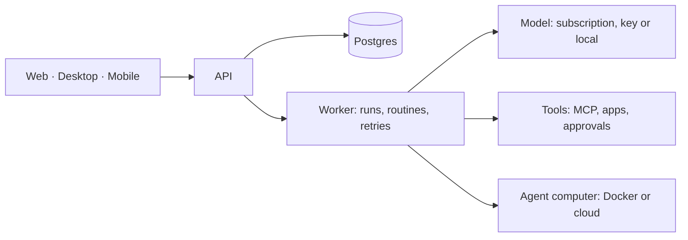

<p align="center">
  
</p>

<h1 align="center">Rook</h1>

<p align="center"><b>AI agents that work as a team. They ask before they act.</b></p>

<p align="center">
  Give each agent a job, its own tools and its own conversation. They work together in channels on your
  computer and check with you before they touch anything real.
</p>

<p align="center">
  <a href="./LICENSE"></a>
  
</p>

<p align="center">
  <a href="https://rookup.run">rookup.run</a> · <a href="./CHANGELOG.md">Changelog</a>
</p>


## Why Rook

- **A team, not a prompt box.** Every agent has a name, a job description and a conversation of its own. Put several in a channel and they hand work to each other.
- **They ask first.** You choose which actions need your yes (send, pay, delete). The agent stops, shows exactly what it wants to do, and waits.
- **Bring your own model.** Your Claude or ChatGPT subscription, your own key, or a model that runs on your machine. Each agent can use a different one.
- **It runs on your computer.** Conversations, memory and files stay with you. No account is needed for the local edition.
- **Open source, end to end.** Apache 2.0. No hosted service is required to run any part of it.

## What it does

### Agents with a job

An agent is an AI with a name, a job description, its own conversation and the tools you give it. You
talk to it like a coworker. It works in the background and comes back with the result. Write one, or
install one from the Store, which ships ready-made agents for finance, operations, marketing,
development, support, sales, design, knowledge and people. Everything about them is editable.


### Channels and squads

Add several agents to a channel and ask. Mention one with `@`, or leave it to the Chief: it reads each
squad's purpose and routes the request to the one that fits. Agents hand work to each other, and every
step is shown.


### Approvals

Set a rule per tool: allow, ask, or block. When an agent wants something that needs your yes, it posts
an approval card with the exact call and waits. You can approve from the app or from Telegram.


### Their own computer

Give an agent a Linux desktop with a browser, a terminal and files. You watch its screen live and can
take control at any moment. Computers run isolated in Docker or in the cloud (E2B, Daytona, Boat,
Railway, CreateOS). On your own machine, the desktop app can work in a folder of its own once you allow
it; commands there are **not** isolated, so grant access only to what you trust.


### Routines and workflows

Run an agent on a schedule or when something new shows up in a connected app. Every run leaves a
history you can open.


### Apps and tools

Connect apps from the built-in catalog (Notion, Linear, Stripe, Sentry, Supabase, Vercel and more) or
any remote MCP server. Each agent only gets the connections you give it, and credentials are encrypted
on the server and never returned by the API.

### Usage

See tokens by day and by agent, and how full your Claude or ChatGPT subscription window is when the
provider reports it.


### Reach them anywhere

Message an agent from Telegram or Slack, or give it an inbox of its own. The reply comes back where you
asked. Voice mode lets you speak and listen with your own speech provider key.

## Models

| Connection | Notes |
| --- | --- |
| Claude subscription | Sign in with your account |
| ChatGPT subscription | Sign in with your account |
| Your own API key | OpenRouter, Anthropic, OpenAI and other compatible providers |
| Local model | Any OpenAI-compatible server, such as Ollama |

Providers are configured through shared connection settings, so adding a compatible one needs no code.

## Install

### Desktop app (recommended)

Runs on your computer with its own database. No account, no server to set up.

**macOS and Linux**

```bash
curl -fsSL https://github.com/corvo-technology/rook/releases/latest/download/install.sh | sh
```

**Windows (PowerShell)**

```powershell
irm https://github.com/corvo-technology/rook/releases/latest/download/install.ps1 | iex
```

Or download the app from the [releases page](https://github.com/corvo-technology/rook/releases/latest):
`corvo-mac-universal.dmg` (Apple silicon and Intel), `corvo-win-x64.exe`, or for Linux
`corvo-linux-x86_64.AppImage` / `corvo-linux-amd64.deb` (x64) and `corvo-linux-arm64.AppImage` / `corvo-linux-arm64.deb` (ARM64).
The same command updates the app later. Details and signing notes: [desktop releases](./docs/desktop-release.md).

On Linux the AppImage needs FUSE 2 (`libfuse2`, or `libfuse2t64` on Ubuntu 24.04). Without it, run
`./corvo-linux-x86_64.AppImage --appimage-extract-and-run`.

### Server for your team

Agents keep working when Rook runs on a server. You need Docker Engine, the Compose plugin, curl and
OpenSSL. No clone and no Node install:

```bash
mkdir -p corvo && cd corvo &&
curl -fsSLO https://raw.githubusercontent.com/corvo-technology/rook/main/infra/compose/install-images.sh &&
bash install-images.sh
```

The installer downloads the Compose files, creates `.env` with random secrets and starts Rook. It
keeps an existing `.env` when you run it again. Open [http://127.0.0.1:5173](http://127.0.0.1:5173),
create an account and connect a model.

For a public server, put HTTPS in front of port 5173 and set `CORVO_HOST`; the
[self-hosting guide](./docs/self-host.md#public-single-vm-deployment) covers Caddy and host hardening.
Restricted networks and mirrors are covered
[there too](./docs/self-host.md#restricted-networks--mirror-downloads). To let an AI assistant do the
install for you, use [SETUP_PROMPT.md](./SETUP_PROMPT.md). You can also
[deploy on Railway](./infra/railway/README.md).

### Editions

| | Local | Self-hosted | Cloud |
| --- | --- | --- | --- |
| Where it runs | Your computer | Your server | Hosted by us |
| Account | None | Email and password | Account |
| Models | Your subscription, key or local model | Same | Same, plus credits |
| Data | On your machine | On your server | Hosted |

## How it works



The frontends express intent and render state. The backend owns orchestration, authorization,
validation, retries and provider translation. Models, computers, memory, voice and integrations are
optional and sit behind provider-neutral interfaces. See [AGENTS.md](./AGENTS.md) for the rules the
code follows.

## Your data

In the local edition everything lives in the app's data folder on your machine. Secrets are encrypted
with a key kept on your machine, and [content encryption](./docs/content-encryption.md) is available for
servers. Nothing leaves your computer except what you send to the model provider you chose.

## Development

You need Node.js 22.22.2 or newer in the 22.x line, 24.x, or 26+, pnpm 9, and Docker. Node.js 23.x and
25.x are not supported.

```bash
git clone https://github.com/corvo-technology/rook.git
cd corvo
cp .env.example .env   # then set the secrets listed inside
pnpm install
pnpm sandbox:build
pnpm dev
```

`pnpm dev` starts Postgres when needed, applies migrations and prints the URL. Required settings,
database roles, ports, providers and troubleshooting are in the [self-hosting guide](./docs/self-host.md).

```text
apps/       web, api, worker, desktop, mobile and the public website
packages/   domain, contracts, persistence, adapters, UI and test tooling
infra/      local services and computer images
docs/       architecture, operations and release guides
```

```bash
pnpm lint
pnpm check
pnpm test
```

Launch the desktop app against the dev stack with `pnpm --filter @corvo/desktop dev` and choose
**Existing instance** with `http://127.0.0.1:5173`. See [CONTRIBUTING.md](./CONTRIBUTING.md) for the
workflow and the full test matrix.

## Languages

The app is available in English, Português (Brasil), Español, Français, Deutsch, 日本語 and 简体中文
under **Settings → Language**.

## Documentation

- [Self-hosting](./docs/self-host.md) and [secrets](./docs/self-host-secrets.md)
- [Sandbox providers](./docs/self-host-sandbox-providers.md)
- [Computer runtime and isolation](./docs/computer-runtime.md)
- [Desktop releases](./docs/desktop-release.md) and [manual release](./docs/desktop-manual-release.md)
- [Mobile releases](./docs/mobile-release.md)
- [Performance testing](./docs/performance.md)

## Contributing

Contributions are welcome. Read [CONTRIBUTING.md](./CONTRIBUTING.md) before opening a pull request. For
security issues, follow [SECURITY.md](./SECURITY.md) instead of filing a public issue.

## License

[Apache License 2.0](./LICENSE). See [THIRD_PARTY_NOTICES.md](./THIRD_PARTY_NOTICES.md) for bundled
software.
