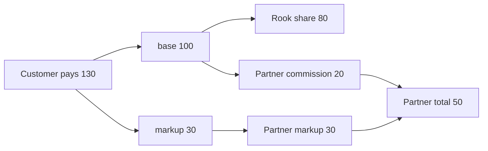
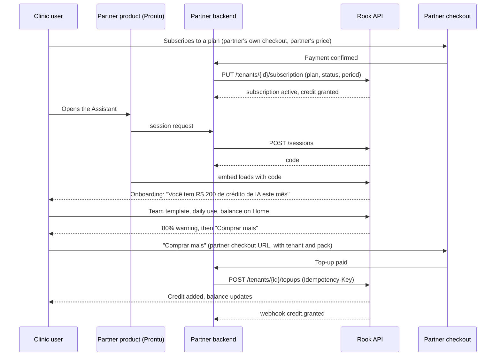
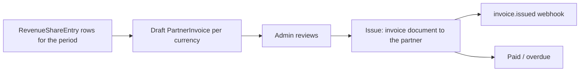

# Partner commerce

Design spec. F1 (the pilot in [partner-pilot.md](partner-pilot.md)) and the server side of F2 (section 15)
are built; the rest is design. All prices, percentages and limits below are **examples** unless stated, and every one is
configurable data (catalog rows, per-partner settings), never code.

## 1. Goals and non-goals

A partner sells Rook agents to its own customers and earns from it. Two delivery modes, one model of
money:

| | Embedded | White label |
| --- | --- | --- |
| Where the customer uses Rook | Inside the partner's product, through the SDK, signed in with the partner's login | A standalone app on the partner's domain, with the partner's brand |
| Example | Prontu, a clinic EHR | A marketing agency selling its own agent system |
| Who sells the subscription | The partner, in its own checkout | Rook, on the partner's behalf, through Stripe Connect |
| Who collects the money | The partner | Rook, into the partner's connected account |
| How Rook is paid | A monthly invoice to the partner for Rook's share | An application fee taken from each charge |
| "Comprar mais" | Opens the partner's checkout URL | Opens Rook's own checkout for a top-up pack |

Shared rules, in both modes:

- Rook sells from a **price list** (the catalog). Each plan includes AI credit.
- The partner earns a **commission** (default 20%, set per partner by Rook) of the catalog price, and
  may add a **markup** it keeps entirely.
- Customers **always use the platform's AI**. No customer-owned subscription or key in partner flows.
- Rook's share never depends on what the partner charged: a discount the partner gives comes out of
  the partner's side.
- No hosted vendor is required to run the core product. Stripe is an adapter behind a provider-neutral
  payments interface (section 12); embedded commerce needs no payment vendor at all.

Non-goals: partner-owned AI keys, revenue share on partner-owned usage, multi-level resellers, usage
metered billing to the end customer.

### The money, worked

Catalog price 100, commission 20%, markup 30 (all in the partner's currency):



- Rook share = `base x (1 - commission)` = 80.
- Partner commission = `base x commission` = 20. Partner markup = 30. Partner total = 50.
- Embedded: the customer pays the partner 130; the partner owes Rook 80 on the monthly invoice.
- White label: the customer pays 130 on the partner's connected account; Rook's application fee is 80.

## 2. Concepts and entities

Existing models are reused where they fit; everything else is new and additive.

| Concept | Meaning | Maps to |
| --- | --- | --- |
| Partner | A company selling Rook; one per product | `Partner` (existing). New columns, see below |
| Mode | `embedded` or `white_label` | New `Partner.mode` |
| Country, currency | Country of the partner; `BRL` for `BR`, otherwise `USD` | New `Partner.country`, `Partner.currency` |
| Commission | Partner's share of the catalog price, in basis points (default 2000) | New `Partner.commissionBps` |
| Customer | One tenant, one organization | `PartnerTenant` + `Organization` (existing) |
| Catalog | Rook's plans and top-up packs, a price per currency | New `CatalogPlan`, `CatalogPlanPrice`, `CatalogPack`, `CatalogPackPrice` |
| Partner price list | Catalog price plus the partner's markup | New `PartnerMarkup`; the list is computed, not stored |
| Customer subscription | The plan a tenant is on, its status and period | New `TenantSubscription`; for white label it mirrors the existing `BillingAccount` pattern |
| Credit ledger | Grants, reservations, settlements, expiry | `ModelCreditAccount`, `ModelCreditLot`, `ModelCreditEntry` and the append-only `BillingAuditEvent` (existing, unchanged) |
| Revenue-share ledger | One immutable row per money event: base, Rook share, partner commission, markup | New `RevenueShareEntry` |
| Partner invoice | Monthly invoice of Rook's share to an embedded partner | New `PartnerInvoice`, `PartnerInvoiceLine` |
| Payout | White label: what Stripe moved to the partner | New `PartnerPayout`, a read-only mirror of Stripe transfers |
| FX rate | USD to BRL used for display and grants | New `FxRate` |
| Brand, domain | White label identity | New `PartnerBrand`, `PartnerDomain` |
| Connect account | The partner's Stripe account | New `Partner.connectAccountId` plus state |

### Money rules for every table

- Amounts are integers in the **minor unit** of a stated currency (`...Minor`); AI credit is integer
  **USD micros**, as in `ModelCreditAccount.balanceMicros`. No floats.
- Ledger tables are append-only. A correction is a new row that references the old one.
- Every money event has a unique `source` string, the idempotency key, like `ModelCreditEntry.source`.

### New tables (sketch)

```
Partner (added columns, all nullable or defaulted)
  mode            "embedded" | "white_label"   default "embedded"
  country         ISO 3166-1 alpha-2           default null
  currency        "BRL" | "USD"                default "USD"
  commissionBps   Int                          default 2000
  billingModel    "wallet" | "commerce"        default "wallet"   -- "wallet" is the pilot, unchanged
  checkoutUrl     String?                      -- embedded: where "Comprar mais" goes
  connectAccountId String?, connectState String?  -- white label

CatalogPlan        id, key ("team"), name key, position, active
CatalogPlanPrice   planId, currency, amountMinor, creditMinor (AI credit in that currency),
                   creditExpires "period_end"
CatalogPack        id, key ("pack_m"), position, active
CatalogPackPrice   packId, currency, amountMinor, creditMinor
PartnerMarkup      partnerId, kind "plan"|"pack", itemKey, markupMinor   -- in the partner's currency

TenantSubscription partnerTenantId (unique), planKey, status, currency, periodStart, periodEnd,
                   baseMinor (snapshot), markupMinor (snapshot), chargedMinor?, source
                   "partner_reported" | "stripe", externalRef, updatedAt
RevenueShareEntry  id, source (unique), partnerId, partnerTenantId, kind
                   "subscription"|"topup"|"refund"|"adjustment", period "2026-11", currency,
                   baseMinor, rookShareMinor, partnerCommissionMinor, markupMinor, reverses?,
                   createdAt
PartnerInvoice     id, partnerId, period, currency, state "draft"|"issued"|"paid"|"void",
                   totalMinor, dueAt, externalRef
PartnerInvoiceLine invoiceId, partnerTenantId, kind, entryId, rookShareMinor
PartnerPayout      id, partnerId, stripeTransferId (unique), currency, amountMinor, arrivedAt
FxRate             id, base "USD", quote "BRL", rate (decimal), source, validFrom
PartnerBrand       partnerId (unique), appName, iconKey, logoKey, accent, supportEmail,
                   senderDomain, senderState, legalUrls (json)
PartnerDomain      id, partnerId, hostname (unique), state "pending"|"verified"|"active"|"failed"
```

`Partner` columns are additive with defaults, so the previous release keeps working during the deploy
overlap. Nothing existing is renamed or dropped.

## 3. Catalog, currency and FX

### Catalog

A single Rook-wide catalog, edited in the Rook admin. Example rows (configurable; not commitments):

| Plan | USD / month | AI credit | BRL / month | AI credit |
| --- | --- | --- | --- | --- |
| Personal | 29 | 10 | 149 | R$ 50 |
| Team | 99 | 40 | 499 | R$ 200 |
| Company | 249 | 100 | 1,249 | R$ 500 |

| Pack | USD | AI credit | BRL | AI credit |
| --- | --- | --- | --- | --- |
| Small | 10 | 10 | 50 | R$ 50 |
| Medium | 25 | 27 | 125 | R$ 135 |

Plan ids reuse the entitlement ids in `packages/contracts/src/plans.ts` (`personal`, `team`,
`company`): the plan decides computers, storage and seats exactly as today; the catalog adds the price
and the included credit. Plans are priced **per currency by hand**, not converted, so a BRL price can
be a round, local number.

### Partner currency

Set once, at partner creation, from the partner's country: `BR` gives `BRL`, anything else `USD`. A
partner has one currency; its customers see and pay that currency. Changing it later is a Rook admin
action allowed only when the partner has no active subscription.

### AI cost, display and allowance

- AI cost is **USD micros** internally, as today.
- The catalog states the included credit in the **plan's currency** (what the customer reads: "R$ 200
  de crédito de IA"). When a grant is made, it is converted to USD micros with the stored rate and the
  conversion is recorded on the grant (rate id and rate value), so any grant can be audited.
- **Rate policy** (a Rook admin setting, versioned): a source adapter (provider-neutral, with an
  offline fixture for tests) writes one `FxRate` row per day. The rate used for **grants** is the
  rate on the first day of the period, **minus a safety spread** (default 3%), so the customer
  receives slightly less USD of AI than the naive conversion and Rook is not exposed to a falling
  real within the month. The rate for **display** of balance and usage is the same locked rate for the
  period, so the balance the customer reads never drifts from what was granted. Top-ups lock the rate
  on the day of the purchase.
- Rook bears FX movement inside a period; the spread is its buffer. Prices in each currency are
  re-reviewed by an admin when the rate moves more than a threshold (alert, not automatic).
- Customers never see USD.

## 4. Customer journeys

### 4.1 Embedded (Prontu example)



Steps and product behavior:

1. **Sign up in the partner product.** The partner creates the customer with the existing `PUT
   /tenants/{id}` (unchanged) and reports the plan with the new `PUT /tenants/{id}/subscription`. A
   tenant without an active subscription cannot start runs ("Plan inactive"), the same refusal path as
   a paused tenant.
2. **First open.** The in-embed onboarding shows one line with the balance in the partner's currency:
   "Você tem R$ 200 de crédito de IA este mês" (copy per locale; the amount is data). This replaces any
   explainer; it appears once, then the balance lives on Home.
3. **Team template.** Applied as today from the partner template.
4. **Daily use.** Home shows the remaining balance for the period. Plan credit is used before top-up
   credit.
5. **80% warning.** At 80% of the period's plan credit used, an in-app notice appears and the partner
   gets `credit.low` (the existing `tenant.allowance_low`, now also covering commerce tenants). The
   notice offers one action: "Comprar mais".
6. **"Comprar mais"** opens the partner's `checkoutUrl` in a new tab with
   `?tenant=<externalTenantId>&pack=<key>` (the pack is a hint; the partner may show its own picker).
   Rook never shows prices in the embedded app except the balance.
7. **Top-up.** The partner's checkout collects, then the partner's backend calls the top-up API. The
   credit appears immediately; the app refreshes the balance through the existing realtime channel.
8. **Period end.** Plan credit expires (section 9.3); the next period's grant arrives when the partner
   reports the renewal (or, if the partner reports nothing, the subscription lapses after a grace
   period, section 9.2).

If the partner has no `checkoutUrl`, the button is hidden and the warning only reads the balance.

### 4.2 White label

```mermaid
sequenceDiagram
  participant U as Customer
  participant W as App on partner domain
  participant R as Rook API
  participant S as Stripe Connect
  U->>W: Signs up (Rook account, partner brand)
  W-->>U: Plan picker with the partner's prices
  U->>W: Chooses a plan
  W->>R: Create checkout for plan
  R->>S: Subscription checkout on the partner's connected account, application fee = Rook share
  S-->>U: Hosted checkout
  S->>R: Webhook: subscription active
  R-->>W: Credit granted, app opens with full branding
  U->>W: Uses the app; "Comprar mais" opens a top-up checkout
```

1. **Signup on the partner's domain** (`app.agency.example`). The account, emails and legal pages are
   the partner's brand (section 8). The customer is a regular Rook organization owned by the customer
   (not the single-owner tenant of the embedded mode): white-label customers have their own members,
   seats and billing portal.
2. **Choose a plan.** Prices shown are the partner's list (catalog plus markup) in the partner's
   currency.
3. **Stripe Connect checkout.** Rook creates the subscription on the partner's connected account with
   an application fee equal to Rook's share (section 7.2). The customer pays the partner's price.
4. **Same app, partner branding.** Everything else is the standard Rook web app with the brand applied
   from `PartnerBrand`; the host decides the brand.
5. **Top-ups.** "Comprar mais" opens a Stripe checkout for a pack on the same connected account with
   the same fee rule. Rook grants the credit from the webhook, never from the redirect.
6. **Billing portal.** Stripe's customer portal, configured per connected account, handles card
   changes and cancellation; plan changes go through Rook so the fee and the grant stay consistent.

## 5. Partner API additions

Base: `/api/partner/v1`. Same auth as the pilot: `Authorization: Bearer <partner key>`. Every
mutating call takes an `Idempotency-Key` header (required for money calls). Amounts are minor units.
All refusals keep the pilot's rules: wrong or missing key is one `401`; another partner's customer is
`404`.

These endpoints exist for partners with `billingModel: "commerce"`. For `"wallet"` partners (the
pilot) they answer `409 {"error":"not_commerce_partner"}`.

### 5.1 Catalog and prices

```
GET /catalog
→ { "currency": "BRL",
    "plans": [ { "key": "team", "baseMinor": 49900, "markupMinor": 5000, "priceMinor": 54900,
                 "creditMinor": 20000 } ],
    "packs": [ { "key": "pack_s", "baseMinor": 5000, "markupMinor": 500, "priceMinor": 5500,
                 "creditMinor": 5000 } ] }
```

`priceMinor` is what the partner should charge. It is advice for embedded partners (they set their own
checkout price) and is enforced for white label.

### 5.2 Set a customer's plan and status

```
PUT /tenants/{externalTenantId}/subscription
Idempotency-Key: <uuid>
{ "plan": "team",
  "status": "active",                 // active | past_due | canceled
  "currentPeriodStart": "2026-11-01T00:00:00Z",
  "currentPeriodEnd":   "2026-12-01T00:00:00Z",
  "chargedMinor": 54900,               // optional; what the customer actually paid, for statements
  "externalPaymentId": "pay_9" }       // optional; a later refund names it
→ 200 { "tenantId": "...", "plan": "team", "status": "active",
        "period": "2026-11",
        "credit": { "currency": "BRL", "grantedMinor": 20000, "usedMinor": 0, "remainingMinor": 20000 },
        "rookShareMinor": 39920 }       // base 49900 x 80%
```

- A new period (a `currentPeriodStart` later than the stored one) grants that period's plan credit
  once; repeating the call changes nothing.
- A plan change inside a period follows section 9.1.
- `status: "past_due"` keeps access during the grace period; `"canceled"` ends at `currentPeriodEnd`.
  Pause and resume keep working as in the pilot and are independent of billing status.
- Unknown plan: `422 {"error":"unknown_plan"}`. Currency is the partner's; there is no currency field.

### 5.3 Add a top-up

```
POST /tenants/{externalTenantId}/topups
Idempotency-Key: <the partner's payment id>
{ "pack": "pack_s", "quantity": 1, "paidMinor": 5500, "externalPaymentId": "pay_123" }
→ 201 { "topupId": "...", "creditMinor": 5000,
        "balance": { "currency": "BRL", "remainingMinor": 24100 },
        "rookShareMinor": 4000 }
```

A repeated `Idempotency-Key` returns the original answer with `200`. A different body under the same key
is `409 {"error":"idempotency_conflict"}`. A suspended tenant: `409 {"error":"tenant_suspended"}`.

### 5.4 Balance and usage

```
GET /tenants/{externalTenantId}/balance
→ { "currency": "BRL", "period": "2026-11",
    "plan":  { "grantedMinor": 20000, "usedMinor": 16100, "remainingMinor": 3900,
               "expiresAt": "2026-12-01T00:00:00Z" },
    "topup": { "remainingMinor": 5000 },
    "remainingMinor": 8900, "fxRate": "5.12" }

GET /tenants/{externalTenantId}/usage?period=2026-11
→ { "period": "2026-11", "currency": "BRL", "usedMinor": 16100,
    "byDay": [ { "date": "2026-11-03", "usedMinor": 420 } ] }
```

Usage carries totals and dates only, never prompts, outputs, models or customer content (same rule as
the webhook body).

### 5.5 Webhooks

Same delivery, signing, retry and de-duplication as the pilot webhook (`X-Rook-Event`,
`X-Rook-Delivery`, `X-Rook-Timestamp`, `X-Rook-Signature`). New and changed events:

| Event | When |
| --- | --- |
| `tenant.allowance_low` / `tenant.allowance_exhausted` | Existing; now also for commerce tenants, amounts in minor units of the partner's currency plus `currency` |
| `subscription.updated` | Plan or status changed (also by Rook: lapse, refund, admin action) |
| `subscription.lapsed` | The grace period ended without a renewal report |
| `credit.granted` | A period grant or a top-up was applied |
| `credit.expired` | Plan credit expired at period end |
| `invoice.issued` | A monthly invoice to the partner was issued (embedded) |
| `payout.paid` | A transfer reached the partner (white label) |

```
{ "id": "...", "type": "credit.granted", "createdAt": "2026-11-20T12:00:00Z",
  "externalTenantId": "clinic-7", "period": "2026-11", "currency": "BRL",
  "kind": "topup", "creditMinor": 5000, "remainingMinor": 24100 }
```

### 5.6 Key scopes

See section 11. Reading balances needs `commerce:read`; setting plans and top-ups needs
`commerce:write`.

## 6. Partner console

A page in the app for the partner owner (replacing Settings > Partnership as it grows; the pilot's
page stays the entry). Sections appear only when relevant to the partner's mode (progressive
disclosure, no explainer text).

| Section | Embedded | White label | Notes |
| --- | --- | --- | --- |
| Brand and domain | no | yes | App name, icon, logo, accent, support email, domain with verification steps, sender domain |
| Mode | read-only | read-only | Set by Rook at onboarding; shown as a label |
| Country and currency | read-only | read-only | Derived, changed only by Rook |
| Commission | read-only | read-only | Set by Rook; shown as a percentage |
| Markup | yes | yes | One field per plan and pack in the partner's currency; the list shows base, markup, customer price and partner's earnings per sale |
| Checkout URL | yes | no | Where "Comprar mais" goes; `https`, validated; placeholders `{tenant}` and `{pack}` allowed |
| Stripe Connect | no | yes | "Connect Stripe" starts Stripe's hosted onboarding; shows requirements due and payout status |
| Customers | yes | yes | Plan, status, credit used and left, period |
| Usage | yes | yes | Per customer and total, by day, in the partner's currency |
| Statements | yes | yes | Per month: revenue-share ledger rolled up (base, Rook share, commission, markup), exportable CSV |
| Invoices | yes | no | Rook's monthly invoices to the partner, with state |
| Payouts | no | yes | Mirror of Stripe transfers |

Markup validation: a markup is a non-negative amount in minor units with a configurable cap (default
100% of the base). Changing a markup affects **new** charges only; a subscription keeps the price it
was sold at (`TenantSubscription.baseMinor` and `markupMinor` snapshots) until its next plan change,
and white label customers are moved to the new Stripe price at their next renewal with a notice
required by the partner's own terms.

## 7. Rook admin

For platform owners only (the existing `PARTNER_ADMIN_EMAILS` gate, later its own role):

- **Catalog per currency.** Plans and packs, price and included credit per currency, active flag.
  Edits create a new row version; existing subscriptions keep their snapshot.
- **FX policy.** Source, spread, threshold alert, the rate table with a manual override.
- **Per-partner commission.** `commissionBps`, mode, country and currency, `billingModel`. Every change
  is audited with who and why. A change applies from the next period.
- **Invoices to embedded partners.** Generate (draft), review lines, issue, mark paid or void. A draft is
  produced automatically on the first day after period end; issuing is a manual click until the
  process is trusted.
- **Connect fees.** Per partner: the connected account state, fees taken, transfers, disputes and
  refunds, and a reconciliation view that compares the ledger with Stripe.
- **Partner state.** Enable, disable, suspend commerce (stops grants without touching existing
  credit).

### 7.1 Embedded invoices



- One invoice per partner, period and currency. Lines are per customer and event, so the partner can
  reconcile. The total is the sum of `rookShareMinor`.
- Terms: due in 10 days (a setting). An overdue invoice does not stop customers at once; after a second
  overdue period the admin may suspend commerce for the partner (section 9.2).
- Tax and the formal fiscal document: section 9.6.

### 7.2 White label fee

On a direct charge on the connected account, Rook sets the application fee to the Rook share. Because
the share is a fraction of the price the customer pays, the fee is computed **per price**:
`rookShareMinor = baseMinor x (10000 - commissionBps) / 10000`, rounded down to the minor unit, and
passed as an absolute `application_fee_amount` for one-off charges (top-ups). For subscriptions the
fee is applied per invoice by Rook's webhook handler (so a markup or commission change never needs
Stripe object surgery). The Stripe processing fee is the partner's (it is the merchant on a direct
charge); this must be confirmed with the owner (open questions).

## 8. White label specifics

- **Custom domains and TLS.** The partner adds a hostname in the console and creates a `CNAME` to a Rook
  hostname. Rook verifies the DNS record, then issues and renews a certificate through a provider
  behind a small interface (the deployment's edge or ACME; the default cloud uses its CDN's custom
  hostname feature). `PartnerDomain.state` moves `pending`, `verified`, `active`, `failed` and the
  console shows the single next step. A host maps to one partner; the host decides the brand, never a
  query parameter.
- **Branded emails.** Sender domain verification: the partner adds the DNS records (SPF, DKIM, return
  path) for `mail.agency.example`; Rook shows their state. Until verified, mail goes from a Rook
  address with the partner's display name. Templates use `PartnerBrand` (name, logo, accent, support
  email, legal links) through the existing email adapter; no vendor SDK outside the adapter.
- **App name and icons.** Web: name, favicon, logo, accent, `theme-color` and manifest per host.
  Desktop and mobile apps are **not** rebranded in this design (store listings are per publisher);
  white label customers use the web app and the installable web app (PWA) manifest.
- **Legal pages.** Terms and privacy URLs are the partner's own, required before activating the domain;
  Rook links them in signup, emails and the footer. Rook's own data processing terms with the partner
  are a contract, not UI.
- **Data isolation.** Each white-label customer is its own organization; partners never read customer
  content. The partner sees plan, credit, usage totals and dates only, the same as embedded. A
  customer belongs to exactly one partner and one brand, and cannot be moved between partners by an
  API call. Row-level security applies as in the pilot (`partner-isolation` tests are the model for
  new ones).
- **"Powered by Rook".** Nothing is shown in the UI by default. The only remaining Rook trace is in
  legal and transactional footers where the law or the processor requires naming the platform
  (the data processor named in the privacy terms, the Stripe statement descriptor set by the partner).
  Whether the commercial terms require a visible "Powered by Rook" on the free tier is an open
  question; the default is none.

## 9. Accounting rules

Every rule below is a default in data (per partner overrides where noted), applied by the backend. The
frontends express intent and render state.

### 9.1 Proration

- **Upgrade mid-period.** Takes effect at once. The customer is credited for the unused part of the old
  plan and charged for the new one by the collector (the partner, embedded; Stripe, white label). Rook
  adds the **difference in plan credit** to the current period, prorated by remaining days, as a new
  lot. The revenue-share ledger records the difference of base prices, prorated the same way, as a
  `subscription` entry.
- **Downgrade mid-period.** Takes effect at the next period; no refund, no credit change. Entitlements
  that the lower plan lacks (seats, computers) apply from that moment, as in the plan entitlements.
- **Proration unit.** Whole days, the day of change counted for the new plan. Rounding: section 9.7.

### 9.2 Failed payments and suspension

- **Embedded.** The partner owns the customer's payment. The partner reports `past_due`; Rook keeps
  access for a **grace period** (default 7 days, a catalog setting) and stops granting new period
  credit. After the grace period without `active`, the subscription is `lapsed`: runs are refused with
  "Plan inactive" and `subscription.lapsed` is sent. Reporting `active` again restores access at once;
  no data is deleted.
- **White label.** Stripe's retry schedule decides; Rook mirrors `past_due` and `unpaid` from the
  webhook with the same grace period and the same refusal. Customer emails about the failure are the
  partner-branded emails.
- **Partner non-payment** (embedded invoices). Reminder, then the admin may suspend commerce for the
  partner: no new grants, existing customers keep what they have until the end of their period.

### 9.3 Unused credit

**Recommendation: plan credit expires at period end; top-up credit does not expire for 12 months.**

- Plan credit is a use-it-or-lose-it allowance: it is priced into the subscription, rolling it over
  would let a customer stockpile and would break Rook's cost model. A lot with `expiresAt` at the end
  of the period is exactly what `ModelCreditLot` supports already.
- Top-ups are separately purchased, so they should not vanish at month end; they expire after 12
  months (`expiresAt = purchase + 12 months`, a setting) so liabilities are bounded.
- Consumption order: the lot that expires first, so plan credit goes before top-up credit.
- Expiry emits `credit.expired` with the amount and writes a ledger event; no money moves.

### 9.4 Refunds

- Refund policy and who decides it belong to the **collector**: the partner (embedded) or the partner
  through the console (white label).
- Embedded: the partner reports a refund with `POST /tenants/{id}/refunds {"externalPaymentId", "amountMinor"?}`
  (scope `commerce:write`). Rook writes a negative `RevenueShareEntry` that reverses the original share
  (full refund) or its proportion (partial), and removes the unused part of the related credit; credit
  already used stays used (Rook's AI cost is real).
- White label: a refund in Stripe triggers a negative entry and the proportional application-fee
  refund; the console action calls Stripe, the ledger follows the webhook.
- A refund after the monthly invoice was issued becomes a credit line on the next invoice.
- Chargebacks follow the refund path; the dispute fee is the partner's on a direct charge.

### 9.5 FX

See section 3. Ledger rows keep the partner's currency and the `fxRate` used for any USD conversion,
so no restatement is needed. Rook's own reporting of BRL revenue in USD uses the rate on the entry
date and is a finance concern, not a product surface.

### 9.6 Taxes (needs an accountant)

Flagged, not decided. This must be resolved with an accountant **before F2 goes live**:

- **Brazil, BRL.** Rook's invoice to an embedded partner is a service invoice (**NF-e de serviço, NFS-e**)
  issued by Rook's Brazilian entity; the partner invoices its customers separately. For white label,
  who issues the customer's fiscal note (the partner as merchant on a direct charge; Rook for its own
  application fee) must be confirmed. Withholding taxes (retenções), ISS municipality, and PIS/COFINS
  treatment of the partner's commission are open.
- **Elsewhere, USD.** Sales tax, VAT or GST on Rook's invoice to a foreign partner, reverse charge and
  the data the invoice must carry.
- **Whether the commission is a discount on a sale or a separate service** changes the taxable base on
  both sides. The ledger keeps base, Rook share, commission and markup apart so either treatment can
  be reported without a migration.
- The product stores tax ids and addresses on the partner and shows tax lines on invoices only once
  this is decided. Until then invoices are issued as documents without a fiscal note and the admin
  marks the NF-e number by hand (`PartnerInvoice.externalRef`).

### 9.7 Rounding

- Integer minor units everywhere; no float arithmetic on money.
- Rook share rounds **down** to the minor unit, so the partner's side gets the remainder (commission =
  base minus Rook share, never computed separately). Rook's share plus the partner's commission always
  equals the base exactly.
- Proration rounds down per line. Display of balance rounds to the minor unit, down for the remaining
  balance (never shows more than exists).
- FX conversion to USD micros rounds down.

## 10. Data model additions by mode

- Embedded customers keep the pilot's shape: one `PartnerTenant` with one owner user.
- White label customers are normal organizations with members, plus a link row to the partner so the
  host, brand and fee apply. This link is a new table (`PartnerCustomer`: partnerId, organizationId,
  externalRef?) and does not use `PartnerTenant` (which implies a single owner and a partner-controlled
  lifecycle).
- `billingModel` selects the credit source: `wallet` draws from the owner's wallet (pilot, unchanged),
  `commerce` grants lots from the catalog. Both write through the same credit ledger and the same
  reserve and settle path, so runs are indifferent to the source.

## 11. Security and abuse

- **Key scopes.** `Partner` keys get scopes: `tenants:write` (existing behavior), `commerce:read`,
  `commerce:write`. Existing keys keep `tenants:write` only until a Rook admin grants more. Scopes are
  checked server-side on every route; a missing scope is `403 {"error":"scope"}` after authentication.
- **Idempotency.** Top-ups, refunds and subscription changes require `Idempotency-Key`; stored with the
  request hash and the response for 30 days. The ledger `source` is derived from it, so a replay can
  never add credit twice, even across processes.
- **Abuse limits.** Per-partner request windows (existing) plus: a maximum top-up per call and per day,
  a plan cannot be set on a tenant of another partner, a lapsed tenant cannot receive a top-up without
  an active plan unless the partner's setting allows it.
- **Reconciliation.** A daily job compares the sum of grants with the credit lots, and for white label
  the ledger with Stripe; a mismatch raises an admin alert and never auto-corrects.
- **Webhooks.** Signed as in the pilot (HMAC-SHA256 over `<timestamp>.<body>`, derived secret, replay
  window). Stripe webhooks are verified with the Stripe signature, accepted only for known connected
  accounts, and processed once per Stripe event id.
- **Audit.** Every plan change, top-up, refund, markup change, commission change, domain change and
  invoice transition writes an immutable audit event (extending `BillingAuditEvent`) with the actor
  (partner key prefix, admin user or Stripe event) and no customer content.
- **Secrets.** Stripe tokens, Connect account ids and keys follow the existing secret handling; none are
  in the repo or logs. Tests run offline against a deterministic fake of the payments interface.
- **Markup and checkout URL abuse.** `checkoutUrl` must be `https` and is never fetched by Rook, only
  linked; the link opens in a new tab with `noopener`.

## 12. Provider-neutral payments

A narrow interface for the white-label flow, with Stripe as the first adapter in a composition root:

```
PaymentsProvider
  createConnectedAccountLink(partner) -> url
  createSubscriptionCheckout({ account, priceMinor, currency, applicationFeeMinor, ... }) -> url
  createTopUpCheckout({ account, priceMinor, currency, applicationFeeMinor }) -> url
  refund(chargeRef, amountMinor?) -> result
  parseWebhook(rawBody, headers) -> NormalizedPaymentEvent
```

A shared conformance suite runs deterministically offline against the in-memory fake; the Stripe
adapter reuses it with recorded fixtures. Embedded commerce does not call the interface at all.

## 13. Phased rollout

Every migration is additive (new tables and columns with defaults), so the previous API release keeps
working while the new one starts. Nothing is dropped or renamed.

### F1. The current pilot (done)

Scope: tenants, templates, allowance from the owner wallet, the credit webhook, the embed. See
[partner-pilot.md](partner-pilot.md).

### F2. Embedded commerce

Scope:

- Catalog (admin-edited, with a seed script that is configuration, not code), BRL and USD prices, the
  FX rate table and policy.
- `Partner` commerce columns; `billingModel: commerce`.
- Partner API: `GET /catalog`, `PUT /subscription`, `POST /topups`, `POST /refunds`, `GET /balance`,
  `GET /usage`, the new webhooks, scoped keys, idempotency.
- Credit grants as lots (plan lot expiring at period end, top-up lot expiring in 12 months).
- In-embed onboarding line with the balance, balance on Home, the 80% warning, "Comprar mais" linking
  to `checkoutUrl`, refusal for lapsed plans, in the partner's currency and locale.
- Revenue-share ledger and the monthly draft invoice, issued by an admin from the Rook admin.

Migrations: `CatalogPlan`, `CatalogPlanPrice`, `CatalogPack`, `CatalogPackPrice`, `FxRate`,
`TenantSubscription`, `RevenueShareEntry`, `PartnerInvoice`, `PartnerInvoiceLine`, `IdempotencyRecord`;
`Partner` columns `mode`, `country`, `currency`, `commissionBps`, `billingModel`, `checkoutUrl`,
`scopes`.

Acceptance criteria:

1. A commerce partner with currency BRL and commission 20% reports a Team plan for a customer;
   the customer's balance reads the plan's credit in BRL and runs succeed against it.
2. Repeating the same subscription call or top-up (same idempotency key) changes nothing; a different
   body under the same key is refused.
3. Base 100, markup 30: the ledger shows Rook share 80, partner commission 20, markup 30, with the sum
   exactly the base, in an offline test for every rounding case.
4. At 80% used the customer sees the warning and the partner gets one `credit.low` per period; "Comprar
   mais" opens the partner's `checkoutUrl`; a top-up call adds credit that is used after the plan
   credit and survives the period end, while unused plan credit expires.
5. A `past_due` report keeps access for the grace period; after it, runs are refused and
   `subscription.lapsed` is sent; reporting `active` restores access.
6. A refund reverses the share in the ledger and removes only the unused credit.
7. A wallet partner (pilot) behaves exactly as before; commerce endpoints refuse it.
8. The monthly draft invoice for a period equals the ledger sum and lists every customer.
9. The tax questions in section 9.6 are answered by an accountant before the first real invoice.

### F3. Partner console and statements

Scope: the console in section 6 for embedded partners (markup per plan and pack, checkout URL, read-only
mode, country, currency and commission), customers list, usage, statements (monthly roll-up, CSV
export), invoices view; Rook admin screens for catalog, commission and invoices; audit events.

Migrations: `PartnerMarkup`, `PartnerAuditEvent` (or the extended audit table), `Partner` columns for
console state if any.

Acceptance criteria:

1. A partner sets a markup on a plan; `GET /catalog` and the console show the new price; existing
   subscriptions keep their snapshot.
2. The partner cannot edit commission, mode, country or currency; a request to do so is refused.
3. The statement for a month matches the revenue-share ledger and the issued invoice to the minor unit.
4. A partner sees only its own customers and totals; no customer content anywhere in the console or CSV.
5. Rook admin changes to commission apply from the next period and are audited.

### F4. White label with Stripe Connect and custom domains

Scope: `PartnerBrand`, `PartnerDomain`, `PartnerCustomer`, `PartnerPayout`, the payments interface and
Stripe adapter with Connect onboarding, subscription and top-up checkouts with the application fee,
refund and dispute handling, host-based branding of the web app and emails, custom domains with TLS,
sender-domain verification, the white-label console sections, Rook admin Connect views and
reconciliation.

Migrations: the four tables above plus `Partner.connectAccountId`, `Partner.connectState`; brand assets
reuse the existing object storage.

Acceptance criteria:

1. A partner completes Connect onboarding from the console and the state reads `active`.
2. A customer signs up on the partner's domain, sees the partner's prices (catalog plus markup), pays
   through checkout on the connected account, and lands in the app with the partner's name, icon,
   accent and emails.
3. A 130 charge on a base of 100 at 20% produces an application fee of 80 and a 50 transfer to the
   partner; the ledger matches Stripe in the reconciliation view.
4. A top-up purchase grants credit only from the verified webhook, once, even when the webhook is
   delivered several times.
5. A refund and a failed payment follow section 9; access, credit and the ledger agree.
6. A custom domain goes `pending` to `active` with a valid certificate; a host that is not registered
   serves no partner brand.
7. One partner's customer cannot read or be moved to another partner; isolation tests pass.
8. The conformance suite passes for the fake and the Stripe adapter offline.

## 14. Decisions

The owner answered the open questions of the first draft. Keep it simple.

1. **Catalog values** are set by the owner. The repository ships editable **example** values in a
   seed file (`apps/api/src/commerce-catalog.example.json`, loaded with `partner catalog-seed`), never
   in code.
2. **Markup** is a fixed amount **or** a percentage per plan and pack (F3 stores it in
   `PartnerMarkup`). Until then F2 derives the markup from what the partner reports it charged.
3. **Credit.** Plan credit expires at period end; top-ups last 12 months.
4. **White label merchant of record** is the partner: direct charges, the partner issues the fiscal
   note and pays the Stripe fees (F4).
5. **Commission base.** 20% is computed on the full price, **before** processor fees.
6. **Stripe Connect for Brazil and BRL** is still to be confirmed; the payments interface stays
   provider-neutral (F4).
7. **Taxes** are settled with the accountant before the first real invoice (section 9.6).
8. **FX.** A 3% spread, rate locked monthly.
9. **A lapsed customer keeps read-only access.** Runs are refused ("Plan inactive."), data stays
   viewable.
10. **One mode per partner.** Two modes means two partners.
11. **One commission rate per partner**, which also applies to top-ups.
12. **No "Powered by Rook"** in white label.
13. **Greenflow** is migrated from wallet to commerce after F2.
14. **No free trials for now.** There is no trial status and no trial logic.
15. **Web only.** No branded desktop or mobile apps.

## 15. F2 as built (server side)

What shipped, and where it differs from the sketch above.

- **Tables.** The F2 list plus `CreditGrant` (what each credit lot was for, with the FX rate id and
  value applied, and the credit as the customer reads it) and `CommerceSetting` (policy as data:
  grace days, FX spread, top-up expiry, invoice terms, top-up limits). `partner_webhook_events` gains
  a nullable `payload`. `Partner.scopes` defaults to `{tenants:write}`, so existing keys behave as
  before.
- **Lots.** Grants use the existing credit lots (`purchase:commerce:...` sources), so the existing
  reserve and settle debit the lot that expires first: the plan lot (period end) before the top-up
  lot (12 months). Each grant has a source derived from the period or the call's idempotency key,
  so a replay never adds credit twice, across processes.
- **Idempotency.** `IdempotencyRecord` stores the request hash and the response for 30 days. The
  same key and body answers 200 with the first answer; another body or route under the key is
  `409 idempotency_conflict`; a call still running is `409 idempotency_in_progress`. Only successes
  are remembered, so a partner can repeat a refused call under the same key after fixing the cause
  (a paid top-up whose tenant was paused, for example).
- **Rounding.** As section 9.7, in `commerce-money.ts` with BigInt in the middle and a table test.
  Partial refunds reverse `floor(total x refunded / paid)` cumulatively and the full amount exactly,
  so any sequence of refunds sums to the original with nothing left over.
- **Markup in F2.** The ledger markup is `max(0, paid - base)` where `paid` is `chargedMinor` on a
  subscription and `paidMinor` on a top-up; a discount lowers only the partner's side. `GET /catalog`
  returns `markupMinor: 0` and `priceMinor = baseMinor` until F3 adds `PartnerMarkup`.
- **Plan changes.** An upgrade adds the prorated credit difference as a new lot and a prorated
  `subscription` ledger row. A downgrade is stored as `pendingPlanKey` and changes nothing until the
  next period. Plan entitlements (seats, computers) for embedded tenants are **not** wired in F2.
- **Lapse.** `active` runs to the period end plus the grace period; `past_due` runs for the grace
  period from the first report; `canceled` runs to the period end. After that runs fail with "Plan
  inactive." A customer with no plan at all is refused the same way. A top-up for a lapsed customer
  is refused with `409 plan_inactive` (no per-partner override yet).
- **Webhooks.** New events carry `currency` and minor units: `subscription.updated`,
  `subscription.lapsed`, `credit.granted`, `credit.expired`, `invoice.issued`; `tenant.allowance_low`
  and `tenant.allowance_exhausted` also cover commerce customers (once per period). `payout.paid` is
  F4. Events are recorded only for partners with a webhook URL and use the existing signed delivery.
- **Not in F2:** the automatic FX source adapter (a rate is written by `partner fx-set`, or any
  writer of `fx_rates`; the lock and spread policy are in place), the daily reconciliation job, and
  suspending a partner's commerce for unpaid invoices. All three are follow-ups.
- **Admin.** Platform admins (the `PARTNER_ADMIN_EMAILS` gate) have `platform.invoices.list`,
  `draft` and `setState` RPCs; the reconciler also drafts the month that just ended. CLI:
  `partner commerce`, `partner catalog-seed`, `partner fx-set`.
- **In-app RPC.** `billing.partnerBalance({ pack? })` returns, for the caller's own organization,
  `{ currency, planName, planCredit, used, remaining, topupRemaining, periodEnd, state, checkoutUrl,
  lowThresholdReached }` in minor units, or `null` for anyone who is not a commerce customer.
  `remaining` is the plan credit left this period and `topupRemaining` the purchased credit on top of it (sold out is their sum at zero); `state` is `active`, `past_due` or `lapsed`; `checkoutUrl` is the partner's address
  with the customer and pack filled in (`{tenant}` and `{pack}` placeholders, or `?tenant=&pack=`).

## 16. F3 console (server side)

The console lives inside the partner's own workspace and is driven by the `partnerConsole` RPC
namespace. The service functions in `apps/api/src/partner-console/` hold all the logic; the routes
only authorize and translate, so agent tools use the same functions.

- **Who.** An organization manages a partner through `PartnerMember`, so one organization can run
  several partners. The migration backfills a row for every existing partner (the organization of
  its owner, or of the account whose credit pays for it); `Partner.ownerUserId` stays as it was for
  the previous release. Calls need the `manage_partner` permission, which owners hold and the
  default Admin role gets (existing Admin roles are updated by the migration). A partner the
  organization does not manage is answered as not found.
- **Markup.** `PartnerMarkup` stores one rule per plan or pack: fixed (minor units) or percent
  (basis points), capped at 100% of the base. The customer pays `base + markup`; the commission is
  inside the base (section 1), so the partner earns `commission + markup`. `GET /catalog` now
  returns the markup and price. A subscription keeps the price in its snapshot until its period
  ends; the console shows the snapshot, then the current price.
- **Customers.** List (filters: credit low, past due, paused; search; cursor), detail (numbers and
  states only, never conversations), and pause, resume and add credit under an idempotency key.
  Credit given outside a sale is a top-up lot billed to the partner as an `adjustment` row, so it is
  never free to Rook; a wallet partner's credit comes out of its own credit like the allowance.
- **Support session.** A one-use entry address as the customer, valid for a minute, audited.
- **Revenue.** Per-month ledger lines and totals, the partner's invoices, and a CSV statement.
- **Integration.** Key prefix, webhook address, key rotation (the new key is shown once).
- **Audit.** `PartnerAuditEvent` records every console change with who made it, as numbers and ids
  only. Commission, mode, country and currency cannot be changed from the console.

### 16.1 Embedded credit model (supersedes markup and commission for embedded partners)

In embedded mode the customer belongs to the partner and Rook never bills or controls it. Only the
partner pays Rook: a monthly partner plan with included credits, plus top-ups. All usage of all of
the partner's customers is debited from one fund, the partner's credit wallet. One credit is one
US cent of the fund.

- **What is debited.** Rook-provided model tokens (each model at its own rate), platform voice,
  computer minutes and storage above an allowance. Credit price is provider cost plus Rook's margin.
  Plan credits expire with the period; top-ups follow the configured expiry.
- **Own models are free.** A run on a customer's or partner's own connection (own key, a local or
  self-hosted model, a CLI engine on their own plan) debits no model credits: only deployment
  credentials reach the credit meter. Computer minutes, storage above the allowance and platform
  voice are still debited. The partner's allowed-models list applies only to Rook-provided models.
- **No numbers in code.** Plan tiers, margins per model and per resource, provider costs, top-up
  markup, top-up expiry and the low-balance threshold are one versioned config
  (`PartnerPricingVersion`), written by a platform admin through `platform.partnerPricing`
  (`get`, `publish`, `simulate`). The highest version is live; earlier ones are kept.
- **Simulator.** `simulatePartnerPricing` takes a plan price and credits, a number of customers and a
  usage mix (models with tokens and an `own` flag, voice minutes, computer minutes, storage) and
  returns credits per customer, the cost split between models and infrastructure, Rook's margin and
  how many customers the plan's credits cover. Integer maths, deterministic.
- **Partner controls.** Per-customer monthly credit limit (`creditLimitCredits`; at the limit the
  customer is blocked from Rook-provided AI and `customer.credit_limit_reached` is sent), allowed
  models, auto top-up settings, and `partner.balance_low` when the fund falls under the configured
  share. Console RPCs: `partnerConsole.credits`, `setCustomerLimit`, `setAllowedModels`,
  `setAutoTopup`, `topup` (through Rook's checkout) and `invoices`.
- **Referral and white label** keep section 1: Rook sells, the partner gets the commission plus an
  optional markup. `pricing` and `setPricing` are refused for embedded partners, and `credits` for
  the others.
- **Status.** Built: the config, the simulator, the controls, the RPCs and, in section 16.2, their
  run-time enforcement. Not yet: see the end of 16.2.

### 16.2 Credit model at run time

Everything below applies to customers of embedded partners and to Rook-provided models only. A run
on a customer's own key, a local model or its own CLI plan never reaches the credit meter, so it is
never blocked or debited (`partner-own-model-ledger.test.ts` asserts the ledger is not touched).
The rules are pure functions in `packages/db/src/partner-credit-rules.ts`; the database glue is in
`partner-credit-enforcement.ts`.

- **Limit.** `hostedModelCreditObserver` asks `assertPartnerSpendAllowed` before the run starts and
  before every model call. A customer whose spend since the start of the UTC month has reached
  `creditLimitCredits` is refused with the existing "credit used up" run error
  (`daily_credit_limit`, scope `credit`).
- **Allowed models.** An empty list allows everything; a name matches the model id or
  `provider/model`. A hosted model outside the list is refused with `model_not_allowed` (a new run
  error code and card: "Model not available", "Choose another model."), and the model picker no
  longer lists it for that customer's space. Models the customer connected itself stay listed.
- **Webhooks.** The reconciler records `customer.credit_limit_reached` (once per customer and
  month) and `partner.balance_low` (once until the fund is refilled) in `PartnerWebhookEvent`,
  which the signed delivery pipeline already sends. The fund is low when it is under
  `lowBalanceBps` of what it was filled with this month, or of the last refill if that is larger.
  The "refill" is named by the latest purchase entry, so each refill re-arms the notice.
- **Auto top-up.** When the fund is under `autoTopupThresholdCredits`, one `PartnerAutoTopupAttempt`
  is created per crossing (named by the last refill, unique per partner), so the same crossing never
  starts twice. The attempt goes through the same billing call as `partnerConsole.topup`
  (`billing.purchaseCredits`) as the person whose account holds the fund, is retried with a 15
  minute doubling backoff (at most 6 attempts) and audited (`credit.autotopup_started` and
  `credit.autotopup_failed`). A deployment without billing has no runner, so nothing is claimed.
- **Partner plan.** `PartnerPlan` holds the tier of the live pricing version, its price and included
  credits. Each month the included credits are granted to the fund as a lot named
  `partner-plan:<partner>:<month>` that expires at the end of the month, and the fee is a
  `partner_plan` line on that month's `PartnerInvoice`. Top-ups stay as lots that do not expire.
  `credits.plan` and `planCredits` read from this. A platform admin sets or removes a plan with
  `platform.partnerPlan.set`; renewal runs in the reconciler.
- **Usage split.** `creditUsage.byResource` reports credits per model (by `ModelCreditEntry.model`),
  plus `voice`, `computer` and `storage`. Computer minutes are debited per ended `ComputerRun`,
  storage above `storageAllowanceGb` once for the closed month, and platform voice through
  `debitPartnerResource`, all at the published rates and once per key (a named hold on the
  customer's credit).
- **Not yet.** Voice minutes are not wired to a source (consultations store no duration), so only
  the debit function exists. Auto top-up opens Rook's checkout; unattended charging needs a saved
  payment method in the billing provider, which the billing interface does not offer, and the
  worker process has no billing service, so only the API process runs it. The partner plan fee is
  invoiced but no payment provider collects it (invoices are issued by hand, as in 7.1). The
  automatic model router can still pick a disallowed hosted model; the call is then refused with the
  card above.
